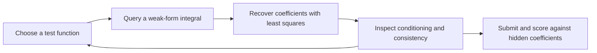

# Can Language Models Learn a PDE?

**A benchmark for experimental design in scientific AI.**

Can a language model choose informative measurements to identify an unknown
elliptic PDE? The model selects test functions, queries weak-form integrals,
inspects numerical diagnostics, and decides when to submit its estimate.
Numerical tools perform coefficient recovery; the model directs the experiment.

[Manuscript](paper.pdf) · [Source](paper.tex) · [Kaggle notebooks](#repository-guide) · [MIT License](LICENSE)

## How it works

The hidden equation is

```text
-(a(x) u'(x))' + b(x) u'(x) + c(x) u(x) = f(x),  x in [0, 1]
u(0) = u(1) = 0.
```

The four coefficient functions are represented in a shifted Legendre basis.
Models can inspect the solution through tools and choose test functions that
vanish at the endpoints. Integration by parts converts each query into a
measurement for a linear inverse problem.



The benchmark records coefficient error, query efficiency, test-function
diversity, and confidence reports. It supports comparisons of query-selection
strategies and prompt conditions on the same seeded PDE instances.

## Reproduce an offline example

Use **Python 3.12** (tested locally with 3.12.12). The pinned numerical environment
includes plotting and analysis dependencies; provider SDKs are optional.

```bash
git clone https://github.com/Hydrodynamical/PDE_Learning.git
cd PDE_Learning
python3.12 -m venv .venv
source .venv/bin/activate
python -m pip install -r requirements.txt

# Run the numerical and protocol regression tests.
python -m unittest discover -s . -p 'test_*.py' -v

# Complete a scripted session: query, solve, submit, and save a dashboard.
python main_loop.py --mock --difficulty easy --seed 42 --output-dir runs/mock
```

On Windows, activate with `.venv\Scripts\activate` instead. The mock uses no API
keys or provider SDKs. It checks the workflow and produces a scored prediction;
it is **not an LLM performance result**. Add `--no-plot` for JSON only.

The [offline workflow](.github/workflows/offline-checks.yml) runs the tests and
example on GitHub Actions without model credentials.

## Run a model experiment

Install the pinned provider environment and set the key for your chosen provider:

```bash
python -m pip install -r requirements-api.txt
export OPENAI_API_KEY="your-key"
python main_loop.py --provider openai --model gpt-4o \
  --difficulty easy --seed 42 --temperature 0 \
  --output-dir runs/standard --no-plot
```

`--provider` also accepts `anthropic` and `google`, using `ANTHROPIC_API_KEY` and
`GOOGLE_API_KEY`, respectively. Pass the desired model ID explicitly; availability
and behavior depend on the provider. The seed fixes the PDE instance, not the
provider's responses. Temperature zero does not guarantee identical API output;
the OpenAI backend omits temperature when a reasoning-effort override is used.

The **standard** condition adds an initial hint about unequal coefficient
identifiability. `--baseline` omits that hint. Both conditions retain the same
PDE, tool instructions, and protocol.

### Compare multiple seeds

For example, run one registered model on three difficulties and two seeds:

```bash
python generate_transcripts.py --models gpt-4o \
  --difficulties easy medium hard --seeds "42 137" \
  --output-dir runs/standard --no-plot

# Repeat the same selection with the baseline prompt.
python generate_transcripts.py --models gpt-4o \
  --difficulties easy medium hard --seeds "42 137" --baseline \
  --output-dir runs/baseline --no-plot
```

Each invocation above attempts six runs. The runner's defaults attempt
**18 standard-condition runs**: three models, three difficulties, and two seeds.
They do not automatically include a baseline ablation. See `MODELS` in
[generate_transcripts.py](generate_transcripts.py) for the registered model IDs.

To resume a sweep, repeat its arguments with `--retry-failed`. Matching includes
model, difficulty, seed, prompt condition, temperature, and reasoning effort.
Legacy summaries missing these settings are preserved and rerun. Use separate
output directories for different conditions/settings so downstream plots and
aggregate tables compare like with like.

## Protocol and outputs

| Difficulty | Basis size per coefficient | Total coefficients | Query budget | Turn limit |
| --- | ---: | ---: | ---: | ---: |
| Easy | 2 | 8 | 12 | 36 |
| Medium | 3 | 12 | 18 | 54 |
| Hard | 4 | 16 | 24 | 72 |
| Extreme | 8 | 32 | 48 | 144 |

Single-run limits can be overridden with `--max-queries` and `--max-turns`.

| Command | Role |
| --- | --- |
| `QUERY: <expression>` | Measure the source integral; costs one query. |
| `COMPUTE: eval_solution <points>` | Inspect the solution and its derivative. |
| `COMPUTE: term_integrals <expression>` | Inspect diffusion, advection, and reaction weights. |
| `COMPUTE: solve` | Recover coefficients from accumulated queries using least squares. |
| `COMPUTE: check <expression>` | Check consistency against a new test function without adding a query. |
| `PREDICT:` | Submit the latest solve coefficients. |

A small consistency residual alone does not establish coefficient recovery:
ill-conditioned measurements can fit well while identifying coefficients poorly.

Every completed invocation writes a timestamped `run_*.json` with configuration,
transcripts, queries, solves, ground truth, and available scores/diagnostics.
Single runs also attempt a dashboard after a prediction; batch runs attempt a
dashboard and AUC plot. `--no-plot` disables plot generation. Batch summaries are
saved to `sweep_results.json`. `--save-transcript` and `--save-plot` take explicit
paths, independently of `--output-dir`.

For a reproducible experiment record, retain the JSON logs, exact command,
`git rev-parse HEAD`, and `python -m pip freeze` alongside your analysis.

## Paper, figures, and archived results

The [revised manuscript](paper.pdf) analyzes the public
[Kaggle run archive, version 1](https://www.kaggle.com/datasets/jkmiller/elliptic-differential-equation-llm-reasoning/versions/1):
**180 scored runs**, six models, three difficulties, and seeds 1–10 in each cell.
All records use the standard prompt. The archive contains scored observations,
not a complete history of failed or retried attempts.

The paper's figures are regenerated from the JSON logs, including a correction
to the older strict-threshold chart: GPT-5.4 mini has **2/10** hard successes at
**total absolute coefficient error below 0.01**. This metric is distinct from
function error evaluated on a spatial grid.

[Reproduction instructions](paper_artifacts/README.md) include the pinned source
URL, archive checksum, figure script, and derived summary. Reproducing these
figures requires no new model calls. Historical provider responses cannot be
recreated exactly from the archive because complete settings and source
revisions were not recorded.

The research revision adds fixed and randomized numerical controls, paired
statistical comparisons, joint-matrix spectra, and precision/refinement audits.
Fixed sine queries recover all 30 reconstructed tasks at the strict threshold
using the minimum permitted solve budget. This limits claims of a benefit from
adaptive language-model measurement selection on these instances. A separate
300-task fresh-seed validation reports both strong fixed-policy recovery and
failures from zero excitation and numerical sensitivity; the paper keeps those
results distinct from the archive.

The earlier three-model, two-seed pilot tables are retained separately in
`paper_artifacts/legacy_pilot_tables.tex`. Their source logs have not been recovered, and they are not
pooled with the six-model study. Saved Kaggle notebooks contain further
exploratory outputs under their own settings.

## Repository guide

| Path | Contents |
| --- | --- |
| [main_loop.py](main_loop.py) | Active single-session CLI, tools, prompts, and backends |
| [generate_transcripts.py](generate_transcripts.py) | Batch experiments, summaries, and resumption |
| `basis.py`, `pde.py`, `weak_form.py` | Numerical problem generation and weak-form operations |
| `expression_parser.py`, `sanitize_expression.py` | Test-function parsing and normalization |
| `benchmark.py`, `diagnostics.py` | Scoring and dashboards |
| `replot.py`, `plot_*.py`, `verify_metacognition.py` | Analysis of saved run logs |
| [kaggle-benchmark.ipynb](kaggle-benchmark.ipynb), [kaggle.ipynb](kaggle.ipynb) | Kaggle-specific exploratory notebooks; require their own Kaggle environment |
| `test_basis.py`, `test_weak_form.py`, `test_parser.py`, `test_cli.py`, `test_sweep.py` | Offline numerical, protocol, and workflow tests |
| [scripts/reproduce_paper_figures.py](scripts/reproduce_paper_figures.py), [paper_artifacts/](paper_artifacts/) | Reproduce the paper figures and audit the archived study |
| [archive/](archive/) | Historical demos and earlier interfaces; outside the supported quick start |
